<div align="center">


# mogdhopaul.com

**The personal site of Mogdho Paul**, a developer and SEO specialist from Bangladesh,<br>
designed like a passport notebook: a green cover, visa-page paper and violet entry stamps.

[**Visit the site →**](https://mogdhopaul.com) &nbsp;·&nbsp; [Admin guide](docs/admin-guide.md)

<br>

<picture>
  <source media="(prefers-color-scheme: dark)" srcset="docs/readme/home-dark.jpg">
  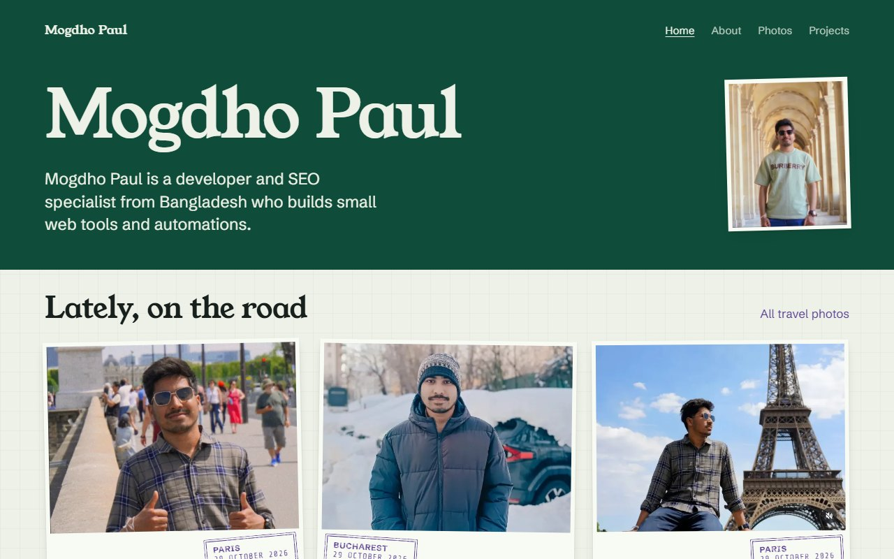
</picture>

<sub>The screenshot follows your GitHub theme: switch to dark mode to see the night cover.</sub>

</div>

<br>

## Design

The whole site borrows from one object, a passport. The header and footer are the **cover**, the
page behind the content is the **visa paper**, photos are **prints** with a stamped place and date,
and the footer ends with a real **passport code line**.

### Colour palette

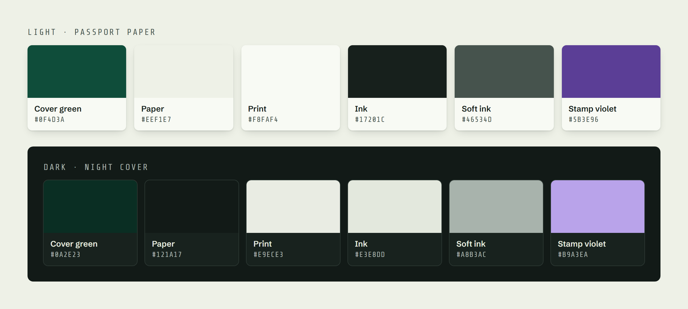

| | Role | Light | | Dark |
|:-:|:--|:--|:-:|:--|
|  | **Cover**: header and footer band | `#0F4D3A` |  | `#0A2E23` |
| 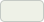 | **Text on the cover** | `#EEF1E7` | 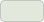 | `#E3E8DD` |
| 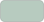 | **Soft text on the cover**: menu links | `#B7CBBF` |  | `#9DB5A8` |
|  | **Paper**: page background | `#EEF1E7` | 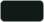 | `#121A17` |
| 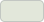 | **Deep paper**: image placeholders | `#E2E7DA` | 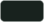 | `#18221E` |
|  | **Print**: photo cards | `#F8FAF4` | 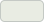 | `#E9ECE3` |
| 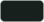 | **Ink**: main text | `#17201C` |  | `#E3E8DD` |
| 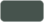 | **Soft ink**: secondary text | `#46534D` |  | `#A8B3AC` |
| 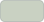 | **Rule**: divider lines | `#C9D1C2` | 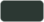 | `#2C3833` |
|  | **Stamp violet**: stamps, links, skill badges | `#5B3E96` |  | `#B9A3EA` |
|  | **Lilac**: logo underline | `#C9B6F2` | | same |

Prints stay light paper in both themes, like real photographs. In light mode the stamp ink is
blended into the paper (`multiply`) so it reads as pressed ink rather than a flat colour.

### Typography

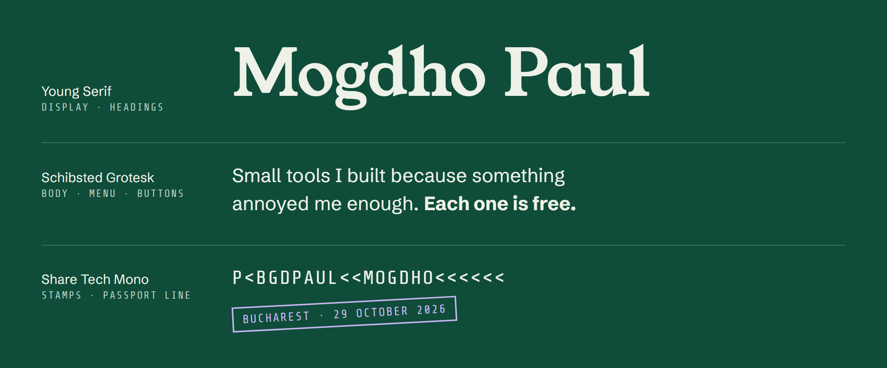

| Typeface | Used for | Sizes |
|:--|:--|:--|
| [**Young Serif**](https://fonts.google.com/specimen/Young+Serif) | The name, headings, project and skill group names | Name 52–96 px · sections 28–42 px · small headings ≈ 21 px |
| [**Schibsted Grotesk**](https://fonts.google.com/specimen/Schibsted+Grotesk) | Body text, menu, buttons (regular to bold, plus italic) | Body 17 px |
| [**Share Tech Mono**](https://fonts.google.com/specimen/Share+Tech+Mono) | Date stamps, skill names, the passport line and Morse code | 12–26 px |

All three are free Google Fonts, served from this site (`fonts/`) rather than from Google.
Sizes that say "52–96 px" grow smoothly with the screen width.

### Layout and spacing

| | |
|:--|:--|
| **Content width** | At most 72 rem (≈ 1150 px); paragraphs stop at 66 characters per line |
| **Side margins** | 16 px on phones, growing to 40 px on wide screens |
| **Spacing scale** | 4 · 8 · 12 · 16 · 24 · 32 · 48 · 72 · 112 px — every gap uses one of these |
| **Breakpoint** | 48 rem (768 px): one column below, wider grids above |

### Details

- **Photos** are paper prints with a soft shadow, each tilted a little (−1.2° to +1.4°), and a violet stamp with the place and date.
- **Skills** are round double-ring entry stamps, pressed slightly crooked, holding single-colour icons.
- **Profile photo** sits on the cover like a passport photo, tilted −1.5°.
- **Logo** is “MP” in Share Tech Mono, cream on cover green, with a lilac underline.
- **Motion** is kept small: prints fade in as you scroll, and nothing moves for visitors who ask for reduced motion.

<br>

## How it works

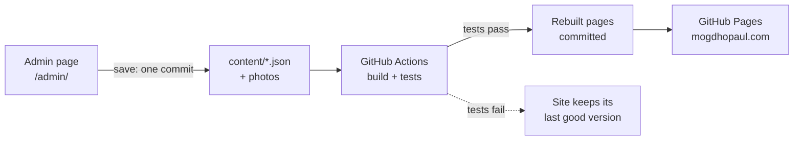

- **Content** lives in three files: `content/site.json` (text, links, skills), `content/projects.json` and `content/photos.json`.
- **The admin** (`/admin/`) edits them in the browser and saves straight to this repository with a GitHub key. Photos are resized and stripped of location data on the device before upload. See the [admin guide](docs/admin-guide.md).
- **The build** (`scripts/build_site.py`) turns content and `templates/` into the pages: home, about, projects, photos, the currency converter and one page per tool (AlwaysNumLock, NN-tab, How Many Times and the rest; listed in `TOOLS` in the build script). Links to files that change carry a content hash (`style.css?v=…`), so the hosting cache never serves an old copy.
- **The tests** check content rules, page structure, SEO basics and style rules before anything goes live.

### Project layout

```
content/        site text, projects and photo list (edited by the admin)
templates/      page templates the build fills in (tools/ holds one per tool page)
scripts/        the build: content checks, page rendering, photo markup
admin/          the browser admin (no server)
photos/img/     travel photos, resized by the admin
skill-icons/    single-colour skill icons saved by the admin
fonts/          self-hosted web fonts
tests/          Python and JavaScript tests
docs/           admin guide and these README images
currency-converter/  the converter's script (its page is built like the others)
<tool>/         built tool pages, e.g. alwaysnumlock/, nn-tab/, how-many-time/, with their images
```

### Run it locally

```bash
python -m scripts.build_site                 # rebuild the pages from content/
python -m unittest discover -s tests -t .    # Python tests
node --test "tests/js/*.test.mjs"            # admin logic tests
python -m http.server                        # then open http://localhost:8000
```

Open `http://localhost:8000/admin/?demo` to try the admin with your local content; demo mode never saves.

<br>

<div align="center">
<sub><code>P&lt;BGDPAUL&lt;&lt;MOGDHO&lt;&lt;&lt;&lt;&lt;&lt;&lt;&lt;&lt;&lt;&lt;&lt;&lt;&lt;&lt;&lt;&lt;&lt;&lt;&lt;&lt;&lt;&lt;&lt;&lt;&lt;&lt;</code></sub>
</div>
